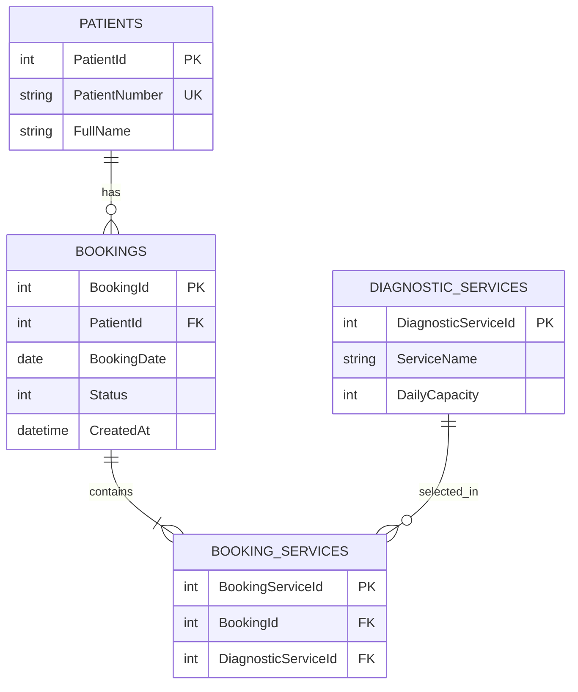

# CareFlow Relational Design

## Relationships and constraints
- One patient can have many bookings; each booking references exactly one patient.
- One booking has one to three booking-service rows.
- Each booking-service row references one diagnostic service.
- A unique index on `(BookingId, DiagnosticServiceId)` prevents a service from appearing twice in the same booking.
- Foreign keys prevent bookings from referencing missing patients or services.
- Availability counts confirmed booking-service rows for the selected booking date.
- Daily capacity is checked again inside the booking transaction before records are committed.
